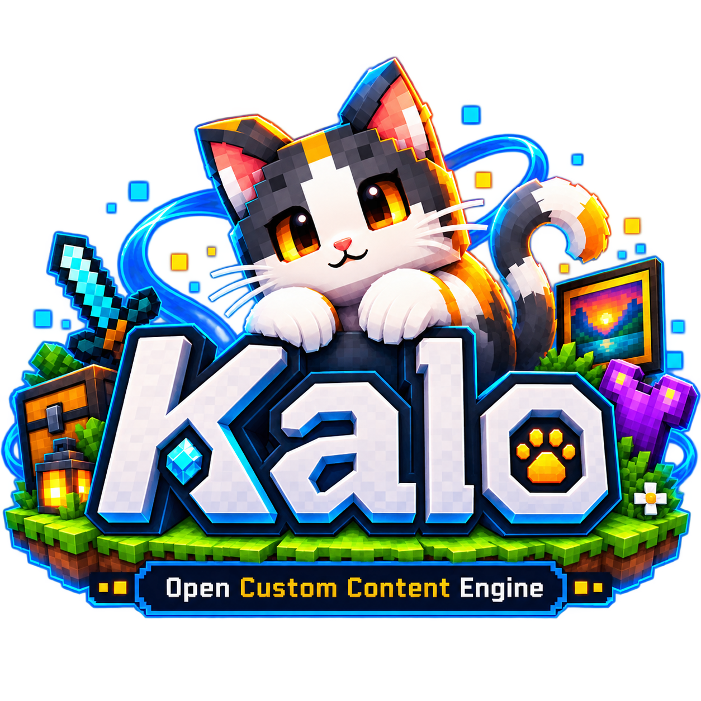
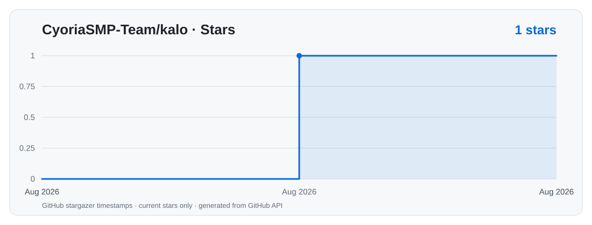

<div align="center">

<p></p>

# 🐈 Kalo

**Open Custom Content Engine for Minecraft**

*Build once. Play everywhere.*

[](docs/RELEASING.md)
[](https://openjdk.org/)
[](https://papermc.io/)
[](https://papermc.io/software/folia)
[](LICENSE)

</div>

<!-- CYTECH_README_REFRESH:START -->
<p align="center"></p>

<p align="center"><sub>Open custom-content engine</sub></p>

<p align="center"><a href="#four-pillars">Four pillars</a> &nbsp;·&nbsp; <a href="#content-packs">Content packs</a> &nbsp;·&nbsp; <a href="#commands">Commands</a> &nbsp;·&nbsp; <a href="#asset-validation">Asset validation</a> &nbsp;·&nbsp; <a href="https://github.com/CyoriaSMP-Team/kalo/issues">Issues</a> &nbsp;·&nbsp; <a href="https://github.com/CyoriaSMP-Team/kalo/releases">Releases</a></p>

<!-- CYTECH_README_REFRESH:END -->

Kalo is a free and open-source engine for building custom items, blocks, furniture and
armor on Paper and Folia servers — no client mods, no player limits, no feature paywalls.

**Bedrock is not a DLC.** One YAML definition compiles to both a Java resource pack and
Bedrock output, because the content model is platform-neutral by design rather than by
translation. That is the thing Kalo exists to do.

> ⚠️ **Pre-alpha.** Items, blocks, furniture, armor, **all recipe stations** (crafting +
> furnace/blast/smoker/campfire/stonecutting/smithing), sounds and glyphs work on Java,
> verified on Paper 26.2 + Folia. Virtual blocks have a persistent index, chunk
> load/unload, explosion handling and a `/kalo migrate-world` dry-run.
>
> **Experimental Bedrock 3D:** Kalo imports Blockbench `.bbmodel` 3.2–5.0 cube
> models into a shared IR, preserving outliner bones, pivots and per-face UVs for Bedrock
> static geometry and emitting Java model JSON from the same source. Rotated bones and
> inflation are refused on Java. Blockbench animation JSON is generated and auto-wired to
> held-item attachables, 3D items receive a rendered isometric inventory icon, and hold
> animations come from authored display transforms instead of the vanilla player-skeleton
> holds. Animated Blockbench blocks and furniture play their loop animations on Java
> through a per-bone display rig, and on Bedrock through a client entity while the block
> surface is made transparent. A `place:` section adds a chunk-saved Java display entity
> and a Bedrock client entity with authored animation; placed models now play their loop
> animations on Java through per-bone display rigs, and a configured interaction clip
> plays once on both platforms before the idle loop resumes. Placed-model storage and
> light/solid/model states are implemented; block/furniture interaction clips now play
> once and resume idle. Blockbench animation controllers compile to Bedrock state
> controllers and drive the Java per-bone rig through a Molang evaluator with state
> variables, remap curves, math functions, arrays, structs, loops, strings, deterministic
> random and blend weights. Bezier keyframes are sampled
> as cubic curves on Java and baked into intermediate linear keys for Bedrock; Catmull-Rom
> keyframes sample the same neighbouring-key spline on Java as Bedrock's `lerp_mode`.
> Each Bedrock session receives its own staged pack that can be filtered by a per-XUID
> content policy and is replaced and re-served on a content update. Custom mobs (`type: mob`), 3D worn armor (`armor_model:`), rideable
> vehicles (`type: vehicle`) and emote props (`type: emote`) compile to Bedrock client
> entities/attachables and to Java display rigs. Mobs, worn armor, placed models and
> animated blocks/furniture play a configured one-shot interaction clip and resume idle.
> Real Bedrock-client validation is still pending. See [docs/BLOCKBENCH.md](docs/BLOCKBENCH.md).
>
> **Bedrock is verified by a Bedrock player**, on a live server running Geyser and
> Floodgate: custom item icons, native blocks placed and mined, and worn armor all render.
> One thing does not, and cannot — see [the roadmap](#roadmap) for that and for everything
> else this is still too young for.

## Four pillars

| | |
|---|---|
| **Open Source** | MIT, no paid tier gating features |
| **Community First** | No player caps, item caps, or premium converters |
| **Paper / Folia** | Compiled against Paper API 1.21.4; runtime verification is tracked separately in the roadmap |
| **Java + Bedrock** | One definition compiles to both. No converter, no companion plugin, no second jar — where Geyser shares the server, there is nothing to install or copy at all |

## Content packs

Packs live in `plugins/Kalo/packs/<pack>/`:

```
mypack/
├── pack.yml                          id, version, author
├── configs/
│   └── items.yml                     content definitions
└── assets/
    └── textures/item/ruby_sword.png  copied into the generated pack
```

```yaml
# configs/items.yml
ruby_sword:
  type: item
  display:
    name: "<gradient:#ff5f6d:#ffc371>Ruby Sword</gradient>"
    lore:
      - "<gray>A blade cut from a single ruby.</gray>"
    glint: true
  model:
    sprite: "item/ruby_sword"
  behaviour:
    durability: 250
  java:
    base_material: NETHERITE_SWORD
```

That compiles to a Java resource pack containing the item definition, the generated
model, the texture, and a lang entry — and the same definition is what the Bedrock
compiler consumes to produce the `.mcpack` and Geyser mappings.

Content keys are namespaced by the pack that defines them, so the item above is
`mypack:ruby_sword` and cannot collide with another pack's.

### Blocks and armor

```yaml
ruby_block:
  type: block
  model:
    cube_all: "block/ruby_block"     # or `cube:` per face, or `custom:`
  behaviour:
    hardness: 3.0
    requires_tool: true
  # java.mode defaults to `native` — a real vanilla block state. Switch to
  # `virtual` (ItemDisplay + anchor) once the 893 native states run out.

ruby_helmet:
  type: armor
  slot: head                          # head | chest | legs | feet
  model:
    sprite: "item/ruby_helmet"        # the hotbar icon
  equipment:
    humanoid: "ruby"                  # what is painted onto the player
  java:
    base_material: NETHERITE_HELMET
```

The default mode is **native**, and it is the one to prefer. A native block is a real
vanilla block placed in a spare state that the pack tells the client to draw differently —
so the server treats it as a block, it costs no entity, and vanilla mechanics apply to it.

```yaml
java:
  mode: native
  carrier: NOTE_BLOCK               # or TRIPWIRE for non-solid decorative content
```

Assignments are persisted in `plugins/Kalo/block-states.json` and never reused. Note Block
gives **799 usable states**, Tripwire adds 63 and Scaffolding adds 31 — **893** native
blocks and furniture in total, filled in that order.

**Virtual mode is what you reach for when those run out.** It swaps the borrowed state for
an invisible Barrier anchor plus a persistent `ItemDisplay` holding the Kalo key in its
entity PDC, which removes the state ceiling entirely:

```yaml
java:
  mode: virtual
```

It removes the **state-count** ceiling, not every trade-off. A server pays for one
persistent display entity per placed block — storage, tracking bandwidth and client
rendering — and entity-backed content does not inherit redstone, piston, fluid or other
native block behaviour. Either way the item model and block model are generated normally,
so the same YAML drives inventory, placement and the Java resource pack.

A sensible pack at scale mixes the two: mechanically meaningful blocks stay `native`,
bulk decorative content goes `virtual`. Existing native worlds can be moved one key at a
time — a key switched to virtual keeps its old state in the generated pack as a legacy
read path, so already-placed blocks do not change appearance.

Armor needs two textures, and they are different things: the `model:` sprite is the icon
in the hotbar, while `equipment:` is the sheet painted onto the player model. Leave
`equipment:` out and the piece is named after itself; set `equipment: {enabled: false}`
to keep the base material's vanilla armor texture.

The same `equipment:` sheet drives **both platforms**. Java paints it onto the player
through an equipment asset; Bedrock attaches a model and hides the vanilla layer beneath.
Two mechanisms with nothing in common, one line of config — which is the whole reason the
definition layer describes intent rather than either platform's output.

### Sounds and glyphs

```yaml
cave_wind:
  type: sound
  category: ambient
  subtitle: "subtitles.mypack.cave_wind"
  sounds:
    - "ambient/cave_wind"        # assets/sounds/ambient/cave_wind.ogg

coin:
  type: glyph
  texture: "font/coin"
  character: "U+E000"            # or a literal character, or a decimal codepoint
  ascent: 8
  height: 9
```

A glyph binds an image to a character, so writing that character draws the image — icons
in chat, item names and menus without a client mod. Use the **Private Use Area**
(`U+E000` and up): those codepoints have no meaning of their own, so nothing in ordinary
text can collide with them. Kalo warns if you pick one outside it, and if two glyphs claim
the same character.

Glyphs are **appended** to the font rather than replacing it. Overwriting
`minecraft:default` outright would drop the providers the game uses for ordinary text and
leave a server where nothing but the icons is legible.

### Recipes

```yaml
ruby_sword_recipe:
  type: recipe
  result: ruby_sword          # or "4x ruby_dust", or "otherpack:thing"
  pattern:
    - " R "
    - " R "
    - " S "
  ingredients:
    R: mypack:ruby            # Kalo content
    S: minecraft:stick        # vanilla
```

Leave `pattern` out for a shapeless recipe. **The namespace decides** whether an
ingredient is vanilla or Kalo content — a pack is free to define `mypack:diamond`, and it
must not silently resolve to the vanilla one, so an unqualified name means "in this pack".

Kalo ingredients match on the id stamped into the item rather than on the whole stack, so
a player who renamed one on an anvil can still craft with it.

Non-crafting stations use `station:` instead of a pattern:

```yaml
ruby_smelting:
  type: recipe
  station: furnace          # furnace | blast_furnace | smoker | campfire
  input: mypack:ruby_ore
  result: mypack:ruby
  experience: 0.7
  cooking_time: 200         # ticks, default 200

ruby_cut:
  type: recipe
  station: stonecutter
  input: mypack:ruby_block
  result: 4x mypack:ruby

ruby_upgrade:
  type: recipe
  station: smithing
  base: minecraft:netherite_sword
  addition: mypack:ruby
  result: mypack:ruby_sword
```

Check what was imported with `/kalo migrate-world` — it reports allocated states in loaded chunks without modifying the world.

### Model sources

```yaml
model:
  sprite: "item/ruby_sword"        # flat sprite, model generated for you
model:
  vanilla: "minecraft:apple"       # reuse a vanilla item's appearance
model:
  custom: "item/ruby_sword"        # a Java model you authored, shipped in assets/
  textures:
    layer0: "item/ruby_sword"
model:
  blockbench: "models/item/ruby_sword.bbmodel"  # .bbmodel under assets/<pack>/
  textures:
    "0": "item/ruby_sword"
place:
  scale: 1.0
  width: 1.0
  height: 1.0
  seat: 0.5        # optional; reserved for the next placed-model slice
  light: 0
  idle: swing     # authored loop animation to start automatically
  interact: swing # authored animation on right-click
```

`.bbmodel` imports keep the outliner hierarchy for Bedrock and compile to a Java model
from the same IR. Held Blockbench item animations are converted to Bedrock animation JSON
and wired to the attachable. An animated block or furniture model is automatically placed
through display entities so Java can play it one bone at a time; Bedrock renders the same
loop through a client entity and hides the static block surface. A `place:` section adds a
Java display entity and a Bedrock client entity with authored animation, including storage
and light/solid/model states. Placed-model Java playback remains unimplemented; each
Bedrock session receives its own staged pack, optionally filtered by content namespace or
key. The exact supported/rejected feature list is
in [`docs/BLOCKBENCH.md`](docs/BLOCKBENCH.md).

## Commands

| Command | Permission |
|---|---|
| `/kalo reload` | `kalo.command.reload` |
| `/kalo give <player> <item>` | `kalo.command.give` |
| `/kalo import <plugin>` | `kalo.command.import` |
| `/kalo import file <path>` | `kalo.command.import` |
| `/kalo doctor` | `kalo.command.doctor` |
| `/kalo migrate-world` | `kalo.command.migrate` |
| `/kalo gui open <player> <namespace:gui>` | `kalo.command.gui` |
| `/kalo hud <namespace:hud>` | `kalo.command.hud` |
| `/kalo dialog <namespace:dialog> [target]` | `kalo.command.dialog` |
| `/kalo dialog open <player> <namespace:dialog> [target]` | `kalo.command.dialog` |
| `/kalo vfx <namespace:vfx> [options]` | `kalo.command.vfx` |
| `/kalo vfx list` | `kalo.command.vfx` |
| `/kalo vfx stop [tag:<name>\|all]` | `kalo.command.vfx` |
| `/kalo liquid corner` | `kalo.command.liquid` |
| `/kalo liquid fill <namespace:liquid>` | `kalo.command.liquid` |
| `/kalo liquid clear` | `kalo.command.liquid` |
| `/kalo click <key>` | none — internal dialog click route |
| `/kalo export kalopack <pack>` | `kalo.command.export` |
| `/kalo inspect-pack <filename>` | `kalo.command.inspect-pack` |
| `/kalo learn-held` | `kalo.command.learn-held` |
| `/kalo discover-packs` | `kalo.command.discover-packs` |

## Mohist / DeadZone compatibility (experimental)

A separate Java-17-bytecode Bukkit 1.20.1 compatibility module is located
in mohist/ and builds Kalo-Mohist-<version>.jar. It is suitable for a Java 21
runtime, such as the current DeadZone server, without changing its Java version.

It discovers Java resource packs and mod asset jars, catalogs Minecraft
namespace-based models/textures/animation metadata and Forge registry IDs,
observes legacy CustomModelData on vanilla carrier items, and exports
experimental 2D plus limited single-sheet static 3D Bedrock assets and
Geyser legacy mappings. A versioned JSON inventory and handoff allows
additional bridge or mod adapters without hardcoding TaCZ. It does not port the native
Kalo content engine or bridge Forge/TaCZ gameplay. See docs/MOHIST_1201.md.

## External Java resource packs (experimental)

Kalo can now observe an existing server ItemStack's Java item_model component
and convert a matching plain model from an authored Java resource pack to a
Bedrock Geyser v2 mapping. This is in addition to, not a replacement for,
Kalo's own YAML item/block engine.

1. Set external-content.enabled: true in plugins/Kalo/config.yml.
   Leave base-pack empty or set it to "auto" and keep
   external-content.auto-discover-packs: true (default). Kalo scans local
   plugin-data directories for real Java Resource Pack ZIPs. If exactly one
   validated candidate exists, it merges the pack automatically. No manual
   ZIP lookup, external downloads or system-wide file scans are required.
2. Set external-content.auto-learn: true to observe actual server-visible
   items in inventories and GUIs automatically; or run /kalo learn-held while
   holding a custom Java item. Observations go to external-items.yml or
   legacy-items.yml.
3. Restart the server/Geyser after new item observations: Geyser's custom-item
   palette is frozen after initialization.

If several different ZIP candidates exist, Kalo does not guess which is in
use or merge incompatible packs. Run /kalo discover-packs for an exact
read-only list and set base-pack to the intended ZIP if needed. An explicitly
configured base-pack always wins and works as before. Files named as backups,
Kalo's own generated.zip, symbolic links, malformed packs and oversized ZIPs
are excluded. Discovery never modifies another plugin's files.

Supported (experimental): plain, conditional (broken/damaged/custom-model-data
flags/component/fishing-rod), range-dispatch (count/damage/custom-model-data/
bundle-fullness), and select (custom-model-data strings, charge type, trim
material, dimension) item models, including the existing static cuboid 3D
converter and plain 2D sprites. CustomModelData-only legacy items can also be
observed and mapped using the base pack's legacy item model overrides;
observations are saved to plugins/Kalo/legacy-items.yml.

Animated textures, composite selectors, complex nested geometry transforms,
external block mappings, skulls, waypoint icons, client-only packs and
mod-specific protocols are not automatically converted. Missing or
colliding assets are reported and skipped. The opt-in feature remains pre-alpha
and requires Bedrock-client verification. See docs/HYBRID_CONVERTER.md.

## Portable KaloPack export

`/kalo export kalopack <pack>` writes an actual, deterministic ZIP archive in
`plugins/Kalo/exports/<pack>.zip`. It contains `pack.yml`, configs and assets;
exports run asynchronously and never overwrite a previous export. Only
lowercase pack names are accepted.

Oraxen, ItemsAdder and Nexo export adapters remain partial/lossy. They are
not available as complete server commands; review API conversion reports.

## Asset validation

After generating, Kalo follows every texture and model reference in the pack and reports
the ones that go nowhere:

```
The generated pack has 1 broken reference(s) — these will render as missing textures:
  assets/testpack/models/item/ruby_sword.json references texture
  'testpack:item/ruby_sword_typo' (expected assets/testpack/textures/item/ruby_sword_typo.png)
```

A mistyped path used to produce no error anywhere — the pack built, the server started, and
the first sign of trouble was a player looking at a magenta cube. It reports rather than
refuses: a pack that is 95% right still loads, with the other 5% named.

## Building on an existing pack

Most servers already ship a pack — a font, a HUD, retextured vanilla. Kalo used to replace
it, forcing a choice between custom content and everything already built.

```yaml
# plugins/Kalo/config.yml
base-pack: "base.zip"    # relative to plugins/Kalo/, or absolute
```

Kalo's generated files win a collision, because they are the half that has to agree with
what the server sends clients — an item definition that disagrees with the `item_model`
component renders as missing texture. Language files and block states merge **entry by
entry** instead, since both packs' contents belong there: your translations survive, and a
base pack cannot take over a note block state Kalo allocated to a custom block.

## Serving the pack

Generating a pack is only half the job — without somewhere to fetch it from, the file sits
in the data folder and no player sees the content. Kalo can serve it itself:

```yaml
# plugins/Kalo/config.yml
pack-host:
  enabled: true
  port: 8163
  public-address: "play.example.com"   # what players actually connect to
  required: false                       # true kicks players who decline
```

Off by default deliberately: it opens a port, and the right public address is something
only you know — a wrong value hands out a URL nobody can reach.

The URL carries a token that rotates whenever the pack is regenerated. Minecraft caches a
pack by URL, so reusing one after a content change would strand every player on the old
pack with nothing to indicate anything was wrong. The SHA-1 is sent with it, which is what
lets an *unchanged* pack come from cache — the reason `ZipPackWriter` is deterministic.

This is the piece Kalo Cloud would later replace with a managed CDN. Self-hosting stays
free and fully functional.

## Add-ons

A third-party plugin can add its own content type — Kalo's own five are registered the
same way, through the same registry:

```java
@EventHandler
public void onRegistryInitialize(RegistryInitializeEvent event) {
    event.getRegistries().types().register(MyType.KEY, new MyType());
    event.getRegistries().features().register(MyFeature.KEY, new MyFeature.Factory());
}
```

Use the default event priority. Kalo reads content packs at `HIGHEST`, which runs last, so
a type registered at normal priority is in place before any pack is parsed.

A `ContentType` parses its own YAML, owns its registry, and contributes its own resource
pack assets — see `docs/IR_DESIGN.md` for the rule its definitions have to follow.

## PlaceholderAPI

Registered automatically when PlaceholderAPI is installed; nothing to configure, and
nothing happens on servers without it.

| Placeholder | Gives |
|---|---|
| `%kalo_held_id%` | the Kalo id of the held item, empty if it is not Kalo content |
| `%kalo_held_name%` | its display name as plain text |
| `%kalo_is_held_<key>%` | `true` / `false` |
| `%kalo_count_<key>%` | how many are in the player's inventory |
| `%kalo_items%`, `%kalo_blocks%` | how many are registered |

## Architecture

```
packs/*/configs/*.yml
        │
        ▼
  ItemDefinition            platform-neutral (no Bukkit, no Geyser)
        │
   ┌────┴────┐
   ▼         ▼
JavaCompiler  BedrockCompiler
   │             │
   ▼             ▼
resourcepack   .mcpack + Geyser mappings
+ ItemStack
```

The definition layer describes *intent*; each platform compiler owns every
platform-specific decision. `Material` appears only in `JavaOptions`, never in the
definition itself. See [`docs/IR_DESIGN.md`](docs/IR_DESIGN.md) for why this is the
load-bearing decision of the whole project.

Kalo writes its own resource packs rather than depending on a third-party pack library —
pack compilation is the product, and being blocked on someone else's release schedule
every Minecraft version is not an option. See [`docs/PHASE0_AUDIT.md`](docs/PHASE0_AUDIT.md) §2.4.

Deliberately **not** in v0.1: a scripting language, web editor, marketplace.
The basics have to be solid first; custom mobs now have a basic spawn command and model
pipeline, not a full ability system.

Kalo Cloud, when it exists, sells *operations* — hosting, CDN, build workers — never
features. The Community Edition is standalone forever.

## Development

Requires **Java 21** bytecode for Paper 1.21.4 through 26.2 (Minecraft 26.x itself
requires Java 25 to run). One jar spans that range; `pack_format` auto-selects 46 for
1.21.4, 88 for 26.2. Verified at runtime on 26.2 and 1.21.11; the 1.21.4 floor is compiled
against but untested. The Gradle toolchain provisions the needed JDK automatically.

```bash
./gradlew build          # build + test
./gradlew runServer      # test Paper server
./gradlew runFolia       # test Folia server
```

Output: `build/libs/Kalo-<version>.jar`

### Modules

- **`api`** — public API: content model, definitions, registries, features, pack model
- **`core`** — implementation: managers, compilers, pack writer, commands, Geyser bridge

## Migrating from another plugin

| From | Items | Blocks | Furniture | Recipes |
|---|---|---|---|---|
| **Oraxen** | ✅ | ✅ | ✅ | ✅ |
| **ItemsAdder** | ✅ | ✅ | ✅ | ✅ |
| **Neko** | ✅ | — | — | — |
| **CraftEngine** | ✅ | ✅ | — | — |

```
/kalo import Oraxen
/kalo import ItemsAdder
```

Kalo autocompletes installed plugins that contain a recognised content file. The command
scans the selected plugin's data folder, detects ItemsAdder/Oraxen/CraftEngine/Neko
files, creates `plugins/Kalo/packs/<plugin>/`, writes the converted configs into its
`configs/` folder, and prints the migration report. Copy the source textures/models into
that pack's `assets/` folder, then run `/kalo reload`.

`/kalo impor <plugin>` is accepted as a short alias too.

For a plugin that is not installed, or a single file you want to review first, use the
explicit path form:

```
/kalo import file plugins/Oraxen/items/weapons.yml
```

The format is detected, not asked for, and detection is **scored** rather than
first-match — these formats overlap (several are plain YAML maps
of content keys) so the most confident reader wins. A file nothing recognises is refused
rather than guessed at, because plausible nonsense is worse than a clear no.

The result is written as `<file>.kalo.yml` next to the source, never overwriting.

An add-on can support a format Kalo does not ship with:
`Importers.register(new MyVendorImporter())`.

What matters more than what converts is what does not. Both plugins drive their own
behaviour systems — Oraxen's `Mechanics`, ItemsAdder's `behaviours` — which Kalo expresses
through features instead. Those are **listed as needing hand-porting rather than mapped to
something plausible**, because a mechanic quietly dropped is something a server owner
learns about from their players. Unrecognised keys are reported by name for the same
reason, and non-item sections say how many entries they held so an empty result is not
mistaken for having nothing to do.

Blocks come across too — Oraxen expresses them as items carrying the `noteblock` mechanic,
ItemsAdder keeps them in a `blocks:` section — but **blocks already placed in a world are
not migrated**. All three plugins store a placed custom block as a note block in some
state and each decides independently which state means what, so existing blocks will read
as the wrong block until they are replaced. The importer says this every time it converts
one, because it is the most expensive thing to discover after going live.

Furniture converts too, but it is a **downgrade in capability, not a format change**. Both
plugins build furniture from entities, which buys rotation, custom hitboxes, seats and
multi-block models. Kalo's furniture is a single static block. The name and shape come
across; none of that behaviour does, and the importer names each lost property
individually — a chair losing its seat and a lamp losing its hitbox need different
follow-up work.

Both importers are written against the documented formats rather than validated against a
corpus of real packs, so treat a first import as a draft to review.

## Bedrock setup

Bedrock output is built when Geyser shares this JVM, when `bedrock-standalone.directory`
is configured, or when `bedrock: always` is set. A Java-only server with `bedrock: auto`
gets no `.mcpack` and no mapping file, because it has no use for them — at a thousand
items that is thousands of files written for nobody. Use `never` to skip it outright.

**If Geyser runs as a plugin on the same server — the usual setup — there is nothing to
install and nothing to copy.** Kalo registers its blocks with Geyser directly through
Geyser's own API:

```
[Kalo] Registering Kalo items, blocks and resource pack with Geyser directly — no extension needed
[Kalo] Registered and mapped 2 block(s) with Geyser natively; 1 virtual block(s) render as entities instead
[Kalo] Registered 8 item(s) with Geyser natively
[Kalo] Kalo Bedrock packs are staged per session
```

Items and blocks are registered through Geyser's own API, so there is no mapping to copy.
The pack is handed to Geyser too, but one copy per session rather than one shared archive:
at login Kalo writes `plugins/Kalo/bedrock-packs/<xuid>.mcpack` and registers that file, so
two players never negotiate over the same cached object. The archive is a deterministic zip
whose `kalo-session.json` marker records the XUID and the SHA-256 of the `generated.mcpack`
it was built from; it is only rebuilt when that source hash changes.

When content is regenerated while Bedrock players are online, Kalo stages the new copy and,
with `bedrock-packs.transfer: true` (the default), transfers those sessions back through
their join address so the next login reads the replacement. A player who joins later always
gets the current revision. Set `bedrock-packs.transfer: false` to apply updates only on the
next natural login, or `bedrock-packs.per-player: false` to go back to one global pack.

Reading from the live registry rather than a file is the point: there is nothing in
between to go stale, so regenerating content cannot leave Bedrock on an old copy.

Geyser reports its own tally on the next lines, and it should match. If Kalo says it
registered blocks and Geyser does not count them, the two disagree and nothing will render
— that is worth reading rather than scrolling past.

### Geyser on a Velocity proxy

This is a different topology from "Geyser is not installed". Geyser runs in the proxy's
JVM; Floodgate runs on the backend. The backend cannot call Geyser's JVM API, so Kalo
exports files and never attempts an in-process cross-JVM registration:

1. Set `bedrock: always` on the Paper/Folia backend (or configure
   `bedrock-standalone.directory`).
2. Copy `plugins/Kalo/generated.mcpack` into the proxy Geyser's `packs/` folder.
3. Copy `plugins/Kalo/geyser/kalo-items.json` and `kalo-blocks.json` into the proxy
   Geyser's `custom_mappings/` folder.

Floodgate on the backend authenticates Bedrock players independently; it is not required
for this export and its absence does not disable Java menus. No Geyser-Spigot plugin is
required on the backend for this topology.

### Geyser running standalone

A separate process cannot be reached from inside the server, so it reads the same
decisions out of files instead. **There is no Kalo artifact to install inside Geyser** —
these are Geyser's own `custom_mappings` files, which it reads natively:

1. Copy `plugins/Kalo/geyser/kalo-items.json` and `kalo-blocks.json` into Geyser's
   `custom_mappings/` folder.
2. Copy `plugins/Kalo/generated.mcpack` into Geyser's `packs/` folder.

Repeat both whenever content changes. Items and blocks are two files because Geyser
versions the two formats separately (`format_version` 2 and 1).

Every copy step is a chance to serve stale content, and nothing in a separate process can
tell you when it happened. If you can run Geyser as a plugin on the server, do that
instead — then there is nothing to copy at all.

## Roadmap

Kalo is pre-alpha. This is the honest split between what has been run and what has only
been written. The second and third tables are the ones worth reading before you install it.

### Verified on a running server

| | Where |
|---|---|
| Items, blocks, furniture, armor | Java: Paper 26.2 + Folia |
| All recipe stations | crafting, furnace, blast, smoker, campfire, stonecutting, smithing |
| Sounds and glyphs | |
| Virtual blocks | persistent index, chunk load/unload, explosion handling |
| `/kalo migrate-world` | dry-run |
| Resource pack generation | deterministic zip, item-definition format |
| **Bedrock, as a player sees it** | A Bedrock player on a live Geyser 2.11.2 + Floodgate server confirmed custom item icons, native blocks placed and mined, and worn armor rendering |

Getting that last row took five release candidates. The registration never ran at all;
blocks were named inconsistently between the two paths; armor pointed at a geometry
Bedrock does not define; block items fell back to note blocks; native blocks could not be
mined by anyone. **Every one of those was green in CI**, and two were held in place by the
tests themselves. Treat the rest of this page accordingly.

### Implemented, never actually run

| | What is missing |
|---|---|
| Standalone-Geyser path | The mapping files generate on a real server and match Geyser's documented format, but nobody has copied them into a separate Geyser process and watched it work |
| **Blockbench `.bbmodel` import and static geometry** | Format 3.2–5.0 cube/outliner import, hierarchy-preserving Bedrock bones, Java model output, multi-material attachables and held-item animation JSON are unit-tested. Real Bedrock-client rendering and a real Blockbench project corpus are unverified |
| **Placed-model runtime** | Java display-entity/hitbox placement, per-bone loop animation, Bedrock client-entity assets, registration and reflective spawn/remove/animation are unit-tested. Real Geyser/Cloudburst internals and a Bedrock client are unverified; per-session pack staging and reconnects are unit-tested against files rather than a live Geyser |
| **Custom mobs** | `type: mob` compiles a Blockbench model to Bedrock geometry/entity/animation and registers it; Java spawns the real base mob invisible with a per-bone display rig. `animation: {idle, interact}` selects loops and a right-click one-shot. Spawn via `/kalo spawn`. Real AI/model alignment and a Bedrock client are unverified |
| **3D worn armor** | `armor_model:` compiles geometry/animation and a Bedrock attachable bound to the armor bones; Java hides the flat equipment layer and draws a per-bone display rig at the wearer's feet. `animation: {idle, interact}` selects loops and an empty-hand right-click one-shot. Parent-bone motion is composed on Java; a real client is unverified |
| **Vehicles** | `type: vehicle` spawns an invisible real carrier, one marker stand per declared seat, a following display and a Bedrock client entity. Seat zero drives through Paper's `PlayerInput`; right-click fills the next free seat and sneak ejects. `medium`, buoyancy, air climb/gravity and solid-block collision are unit-tested; a real client is unverified |
| **Emotes** | `type: emote` + `/kalo emote [cast]` plays a prop or player-body rig for one or more performers. `rig: player` hides the vanilla body, runs per-bone Java displays and a Bedrock client entity, and layers a cached or automatically fetched `plugins/Kalo/skins/<uuid>.png` into that player's session pack. Java gets a tiny per-player overlay for the emote's unique texture path when the local pack host is available; real client unverified |
| **HUDs and dialogs** | `type: hud` compiles an image into the Java font and a Bedrock glyph page with horizontal offsets; `type: dialog` writes a Java data pack, resolves title/body/label/tooltip placeholders at open time, authorizes console/multi-command clicks with one-time shown-dialog keys, supports tooltips/after/escape modes and raw Java JSON, and sends a Cumulus form to Bedrock players. Parser, generated JSON/data-pack and click-key paths are unit-tested; Java 1.21.6+ dialogs and live Bedrock form delivery are unverified |
| **VFX** | `type: vfx` parses presets, inline recipes and Studio-style JSON, paints colored sprite textures/models into the Java pack, and runs a deterministic item-display simulation. Sound events, loop build-up/repeat/fade, loop time/cycle limits, conditions (`until`/`while`/`check`) with PlaceholderAPI fallback, graceful stop, tags, speed/scale/follow/offset/turn/delay/seed/only-caster, world-space `motes`, view-anchored `camera` sprites with packet-based Java camera control behind a no-op-fallback seam, `model` display layers with compiled Bedrock model client entities, Bedrock client-entity assets with cast `scale` delivery and the `vfx.max-sprites` budget are implemented. Java `fov` is a dolly approximation, Bedrock players keep their normal camera, and model roll is baked into the Bedrock geometry; a protocol-level live Bedrock check observed the staged pack and sprite/model entities, while rendered visuals and Java camera packets on Bedrock remain unverified |
| **Liquids** | `type: liquid` parses water/lava rules, persists boxes, adds `liquid:` buckets with empty-bucket pickup/refill, expands/trims volumes on fluid flow, trims sponge-absorbed regions and deliberately placed/broken or physics-changed cells (MONITOR-order, idempotence and fluid guards unit-tested), applies effects/damage/fireproof once a second, and writes colored Java biomes. A live Bedrock check observed volume creation/persistence and, in a mob-free void world, isolated acid contact damage as five-point health drops. Colour is per column and needs a restart; live client rendering is unverified |
| The 1.21.4 end of the version range | One jar spans 1.21.4 → 26.2. It has been run on 26.2 and 1.21.11; the bottom of the range is untested |
| Oraxen / ItemsAdder import | Written against documented formats, never run against a real pack. Treat any import as a draft to review |

### Known not to work

| | |
|---|---|
| **Virtual blocks on Bedrock** | A Bedrock player sees nothing where one is placed, and this is structural rather than a bug: a virtual block is an `ItemDisplay` entity, which Geyser does not put on a Bedrock client, and it overrides no Java block state so it cannot be mapped either. Native blocks are unaffected. **On a server with Bedrock players, the 893 native states are the real ceiling** — see [docs/VIRTUAL_BLOCKS.md](docs/VIRTUAL_BLOCKS.md) |

### Not built

| | |
|---|---|
| Verified `pack_format` for 1.21.5 – 1.21.10 | 1.21.4 (46), 1.21.11 (75) and 26.2 (88) are read out of real client jars. The versions between get the nearest number in their family plus a console warning saying it is a guess. Read `pack_version.resource_major` from that version's client jar and add it to `PackFormats` |
| Blockbench block/furniture animation | Loop animations play on Java through per-bone display rigs and on Bedrock through a client entity with a transparent block surface. Placed models and animated blocks/furniture play a configured one-shot interaction clip and resume idle loops. Unit-tested against a synthetic fixture; real Bedrock-client rendering is unverified, and provider-specific Molang queries/entity references remain host supplied |
| Custom mobs on Java | The base mob is invisible and the custom model follows as a per-bone display rig with authored loops and a right-click interaction clip. Parent-bone motion is composed on Java; Bedrock invisibility forwarding is unverified |
| Real server-side block registration | Would still need a borrowed visual state on vanilla clients — see the `BlockCarrier` javadoc |

## License

MIT. Kalo is derived from [Neko](https://github.com/bindglam/Neko) by Woobeen Jeon, whose
copyright notice is retained in [LICENSE](LICENSE) as that license requires.

The RP Engine comparison is documented separately: [docs/CLEAN_ROOM.md](docs/CLEAN_ROOM.md)
records what is independently implemented, what is still missing, and the clean-room rule
that no GPL-3.0 source is copied into this MIT project.

---

<!-- CYTECH_STAR_HISTORY:START -->

## Star History

<a href="https://github.com/CyoriaSMP-Team/kalo/stargazers">
  <picture>
    <source media="(prefers-color-scheme: dark)" srcset="https://raw.githubusercontent.com/CyoriaSMP-Team/kalo/refs/heads/main/assets/star-history-dark.svg" />
    <source media="(prefers-color-scheme: light)" srcset="https://raw.githubusercontent.com/CyoriaSMP-Team/kalo/refs/heads/main/assets/star-history-light.svg" />
    
  </picture>
</a>

<sub>Updated automatically from GitHub's dated stargazers. Only currently starred accounts are included.</sub>

<!-- CYTECH_STAR_HISTORY:END -->
